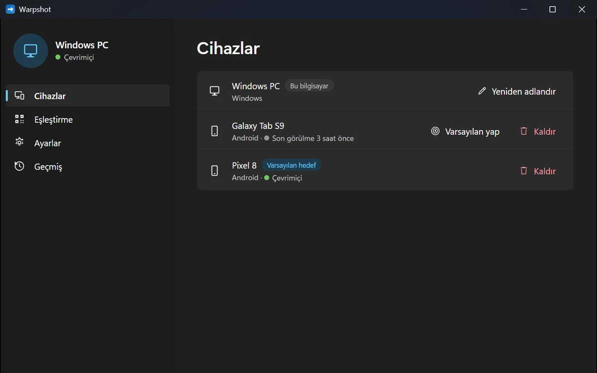

# Warpshot

Fast, end-to-end encrypted transfer of screenshots, text and files between your
**Android phone** and your **Windows PC**: one hotkey, no window, no account.

> **Status:** works end to end and has been in daily use on my own phone and PC
> since October 2026. There are no signed builds or store releases yet: you
> build it from source and deploy your own server ([Build and run](#build-and-run)).
> Open items are in the [roadmap](docs/roadmap.md).

## What it does

- **PC → phone:** take a screenshot (`Win+Shift+S`) or copy text or files, then
  press `Ctrl+Alt+Shift+S`. A small flyout above the taskbar shows the progress.
  A few seconds later the item is on your phone: in the gallery (other files in
  `Download/Warpshot`), on the clipboard, and in a notification with a preview.
- **Phone → PC:** tap Share and pick your PC directly in the share sheet, or send
  photos, files or text from the app. The item lands in your PC's clipboard and
  in `Downloads\Warpshot`.
- **Devices and history** on both sides: which devices are online or can be
  woken up, what was sent and received, and Cancel for a transfer in progress.
- **Large files:** the phone asks before it receives anything above 500 MB (the
  limit is a setting).
- The PC and phone apps follow the system language (Turkish or English).

## Design highlights

- **Direct P2P** over [iroh](https://iroh.computer) (QUIC + TLS 1.3): direct on
  the same Wi-Fi, NAT traversal across networks, an end-to-end encrypted relay as
  a last resort. Relaying data can be turned off. On the same Wi-Fi a 100 MB file
  took 13 s ([measurements](docs/spikes.md)).
- **Post-quantum inner layer:** an X-Wing (X25519 + ML-KEM-768) handshake inside
  TLS, so recorded traffic stays private even against future quantum computers.
- **No accounts, no passwords:** devices form a group by scanning a QR code. The
  group is a member-signed, hash-chained log. The server cannot add devices or
  read anything.
- **$0 server:** a tiny Cloudflare Worker that only authenticates, keeps the
  membership log and wakes devices up (WebSocket, or Firebase Cloud Messaging for
  a sleeping phone).
- **Featherweight Windows agent:** 0.85 MB of private memory, 5 threads and 0 % CPU
  while idle, against a budget of < 5 MB. Measured with `scripts/measure-idle.ps1`
  after every change that touches the agent ([results](docs/resource-budget.md#4-results)).

## Components

| Path | What it is |
|---|---|
| [`crates/core`](crates/core) | the protocol in Rust: membership log, pairing, transfers, wake envelopes |
| [`crates/cli`](crates/cli) | `warpctl`, a command-line peer used for tests |
| [`crates/ffi`](crates/ffi) | UniFFI bindings that bring the core to Android |
| [`apps/windows-agent`](apps/windows-agent) | `warpshot-agent.exe`: tray icon, hotkey, clipboard; always running |
| [`apps/windows-ui`](apps/windows-ui) | `warpshot-ui.exe`: the Tauri v2 window, opened only when needed |
| [`apps/android`](apps/android) | the Android app (Kotlin, Jetpack Compose), Android 10 or newer |
| [`server`](server) | the Cloudflare Worker and Durable Object |

## Build and run

Requirements: Windows (tested on Windows 11), Rust with MSVC, Node.js, Android
Studio with the NDK, a free Cloudflare account and a Firebase project.
[`scripts/setup-dev.ps1`](scripts/setup-dev.ps1) installs the toolchain.

1. **Server:** `scripts\deploy-server.ps1` deploys the Worker to your Cloudflare
   account and writes the PC's config.
2. **PC:** build `warpshot-agent` and `warpshot-ui`, then run
   `scripts\install-windows.ps1` (per user, no admin rights; `-Uninstall`
   removes it).
3. **Phone:** build the Rust library and the release APK, then install it.
4. **Pair:** tray icon → Settings → Pair, scan the QR code with the app and
   compare the code on both screens.

The exact commands, the end-to-end tests and the emulator setup are in
[`docs/dev-setup.md`](docs/dev-setup.md) §8–9.

## Documents

| | |
|---|---|
| [Architecture](docs/architecture.md) | components, flows, storage |
| [Protocol](docs/protocol.md) | normative wire and crypto spec |
| [Threat model](docs/threat-model.md) | what we defend against |
| [Resource budget](docs/resource-budget.md) | the Windows idle budget and how it is measured |
| [Agent IPC](docs/ipc.md) | the named-pipe API between the agent and the window |
| [Spikes and measurements](docs/spikes.md) | iroh, idle cost, wake path, transfer speed |
| [Decisions](docs/adr/) | ADRs |
| [Roadmap](docs/roadmap.md) | done and open tasks with acceptance criteria |
| [Dev setup](docs/dev-setup.md) | toolchain, accounts, deployment |

## Türkçe özet

Telefon (Android) ile bilgisayar (Windows) arasında ekran görüntüsü, metin ve
dosya gönderen açık kaynak bir uygulama:

- **PC'den telefona:** ekran görüntüsü al ya da metin veya dosya kopyala, sonra `Ctrl+Alt+Shift+S`'ye bas. Hiç pencere açılmadan varsayılan telefona gider.
- **Telefondan PC'ye:** paylaş menüsünden PC'yi seçmek yeterli. Gelen içerik PC'nin panosuna ve `İndirilenler\Warpshot` klasörüne düşer.
- **Bağlantı:** P2P, uçtan uca ve kuantum sonrası hibrit şifreli.
- **Hesap yok:** cihazlar QR ile eşleşir.
- **Sunucu:** küçük bir Cloudflare Worker, maliyeti $0.
- **Windows tarafı:** boştayken 0,85 MB RAM kullanır (ölçüldü), işlemci kullanımı sıfıra yakın.
- **Durum:** Ekim 2026'dan beri günlük kullanımda. Henüz imzalı sürüm ya da mağaza yayını yok, kaynaktan derleniyor.

## License

GPL-3.0-or-later (see [`LICENSE`](LICENSE)), with an additional permission for
linking the Google Play Services and Firebase client libraries
([`LICENSE-ADDITIONAL-PERMISSION.md`](LICENSE-ADDITIONAL-PERMISSION.md)).
Security reports: [`SECURITY.md`](SECURITY.md).
